# ¿Un skill mejora la interfaz que genera un agente?

Experimento A/B para medir si el skill [`estandar-interfaz`](skill/SKILL.md), un estándar de diseño y UX para agentes de código, mejora las pantallas que construye un agente de IA. El método es una adaptación de las [vibe-tests de Astryx](https://github.com/meta/astryx/tree/main/internal/vibe-tests) (Meta): mismo encargo, agentes sin contexto previo, solo cambia el sistema que se prueba y un juez califica a ciegas.

## Resultado

| | Con skill | Sin skill |
|---|---|---|
| Preferida por el juez ciego | **10 de 10** | 0 de 10 |
| Puntaje medio del juez (1–5) | **4,45** | 3,63 |
| Pasa el verificador automático | **10 de 10** | 3 de 10 |

Diferencia media (con skill − sin skill) por criterio del juez:

| Criterio | Diferencia |
|---|---|
| Estados (carga, vacío, error) | +2,4 |
| Intención | +1,3 |
| Jerarquía | +1,0 |
| Accesibilidad | +0,6 |
| Calidad visual | +0,4 |
| Responsive | +0,2 |
| Formularios | 0,0 |
| Gráficos | −0,2 |

La ventaja se concentra en **estados, intención y jerarquía**: sin el skill, la mayoría de las pantallas no trataban carga ni error, ponían tarjetas del mismo peso en grilla y no llevaban al detalle. En **responsive, gráficos y formularios** no hay diferencia: el modelo ya los resuelve bien sin ayuda.

Costo: con el skill, cada pantalla usó en promedio ~23 % más tokens, ~30 % más tiempo y ~25 % más líneas de código.

## Por pedido

| Pedido | Tipo | Preferida | Juez con skill | Juez sin skill | Verificador con skill | Verificador sin skill |
|---|---|---|---|---|---|---|
| p01 | tablero-kpi | **con skill** | 4,29 | 3,71 | pasa | 17 táctil < 44 px |
| p02 | tablero-finanzas | **con skill** | 4,50 | 3,71 | pasa | 4 táctil < 44 px, 18 texto < 12 px |
| p03 | formulario | **con skill** | 4,29 | 4,14 | pasa | 2 táctil < 44 px |
| p04 | responsive-tabla-ancha | **con skill** | 4,57 | 3,57 | pasa | 240 texto < 12 px |
| p05 | portal-detalle | **con skill** | 4,86 | 3,33 | pasa | pasa |
| p06 | landing-formulario | **con skill** | 4,43 | 3,86 | pasa | 1 táctil < 44 px |
| p07 | tablero-operativo | **con skill** | 4,71 | 3,29 | pasa | pasa |
| p08 | estados | **con skill** | 4,38 | 3,50 | pasa | pasa |
| p09 | tablero-encuesta | **con skill** | 4,43 | 3,57 | pasa | 7 táctil < 44 px, 42 texto < 12 px |
| p10 | configuracion | **con skill** | 4,00 | 3,57 | pasa | 42 táctil < 44 px, 6 texto < 12 px |

## Método

1. **Proyecto base fijo** ([`harness/proyecto-base`](harness/proyecto-base)): Vite + React 19 + TypeScript + Tailwind v4, con datos ficticios de una empresa inventada (Andes Logística) que genera [`gen-datos.mjs`](harness/gen-datos.mjs) con semilla fija.
2. **Diez pedidos** ([`pedidos.json`](harness/pedidos.json)), escritos como los haría un cliente: tableros, un formulario, un portal, una landing, estados de carga y error, y una pantalla de configuración. El texto es idéntico en las dos condiciones.
3. **Dos condiciones**, cada una en una copia aislada del proyecto y con un agente nuevo (Claude Opus 5.5, sin contexto previo):
   - **A, con skill:** el agente lee y sigue el `SKILL.md`.
   - **B, sin skill:** no puede usar skills; todas las demás herramientas, incluido el MCP de 21st.dev, siguen disponibles.
4. **Calificación automática** ([`evaluar.mjs`](harness/evaluar.mjs)): compila (tsc + vite build), sirve el build y corre [`verificar-interfaz.mjs`](skill/scripts/verificar-interfaz.mjs) a 390, 768 y 1440 px: scroll horizontal, errores de consola o red, áreas táctiles menores de 44 px, nombres accesibles y texto menor de 12 px. También cuenta en el transcript qué herramientas usó cada agente.
5. **Juez ciego** ([`juez.md`](harness/juez.md)): un agente nuevo recibe las dos versiones como X e Y, sorteadas por pedido ([`clave.json`](resultados/2026-11-13/clave.json)), con las capturas y el código. Antes se borran del código las menciones que delatan la condición ([`anonimizar.mjs`](harness/anonimizar.mjs)). Puntúa 8 criterios y elige una.
6. **Agregado** ([`agregar.mjs`](harness/agregar.mjs)): deshace el anonimato y calcula las diferencias.

## Límites — léelos antes de citar el resultado

- **Una corrida por pedido y condición.** Diez pares no permiten estimar la varianza; el resultado es consistente (10 de 10), pero no es una medición de precisión.
- **El mismo modelo construye y juzga.** Un juez humano o de otro proveedor podría preferir otras cosas.
- **La rúbrica sale del checklist del skill.** Eso favorece a la condición A, sobre todo en «estados»: en un tablero con datos fijos en el bundle, una pantalla de carga es código de más, y el juez la premia igual. Los motivos de preferencia, sin embargo, citan casi siempre la jerarquía y el acceso al detalle.
- **La condición A itera contra el mismo verificador que la califica**, así que «pasa el verificador» mide en parte obediencia. La medida independiente es el juez.
- **Dos cambios durante la corrida**, tras el piloto de 4 pedidos (p01, p03, p04, p08):
  - La instrucción de B decía solo «no uses skills». Dos agentes del piloto (p04 y p08) entendieron que tampoco podían usar 21st.dev; desde p02 la instrucción lo permite explícitamente. Sin esos dos pedidos, el resultado es 8 de 8.
  - El piloto encontró que el verificador tomaba la captura antes de que llegaran los datos diferidos. Se le añadió `--esperar <ms>` y una línea al paso 4 del skill. Los agentes A del piloto leyeron la versión anterior. La calificación de las 20 corridas usó `--esperar 3000`.
- **Datos con defectos**, iguales para las dos condiciones: el tema de los comentarios de clima no correspondía al texto, `resolucionHoras` no cuadraba con el estado de los tickets y había facturas «pendientes» ya vencidas. Están corregidos en `gen-datos.mjs`; [`resultados/2026-11-13/datos`](resultados/2026-11-13/datos) conserva los que se usaron.
- **El `SKILL.md` publicado omite los nombres de clientes** de la versión que se usó; el contenido del flujo y del checklist es el mismo.

## Reproducir

Requisitos: Node 22+, Playwright con Chromium, y un agente que pueda lanzar subagentes (aquí, Claude Code).

```sh
cd harness/proyecto-base && npm install && node ../gen-datos.mjs . && cd ../..
cd skill/scripts && npm install && cd ../..
export SKILL_DIR="$PWD/skill"
node harness/preparar.mjs /tmp/evals harness/proyecto-base todos
# Lanza un agente por cada /tmp/evals/runs/<pedido>/prompt-{A,B}.md y anota su transcript en /tmp/evals/agentes.json
node harness/evaluar.mjs /tmp/evals /tmp/evals/agentes.json
node harness/anonimizar.mjs /tmp/evals
# Lanza un juez por cada /tmp/evals/juez/<pedido>/prompt.md
node harness/agregar.mjs /tmp/evals
```

Para probar otro skill, apunta `SKILL_DIR` a su carpeta (necesita `SKILL.md` y `scripts/verificar-interfaz.mjs`).

## Qué hay en `resultados/2026-11-13`

- `resumen.json`: el agregado de la tabla de arriba.
- `resultados-auto.json`: la calificación automática y las herramientas que usó cada agente.
- `juicios/`: los juicios en X/Y, tal como los escribió cada juez.
- `clave.json`: qué condición era X y cuál Y.
- `corridas/<pedido>/<A|B>/`: el código, el `PROCESO.md` del agente y las capturas a 390, 768 y 1440 px.

## Galería a 390 px

### p01 · tablero-kpi

> Haz un tablero de órdenes de compra para el gerente de compras de Andes Logística. Los datos están en src/data/ordenes.json (300 órdenes). Quiere ver cuánto dinero hay comprometido, qué órdenes están atrasadas y poder revisar el detalle de cada orden.

| Con skill | Sin skill |
|---|---|
| 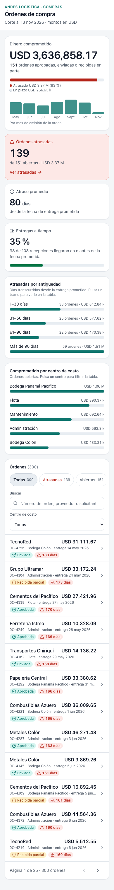 | 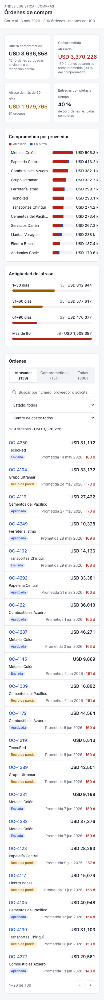 |

**Juez** (X = sin skill, Y = con skill): [con skill] le da un peso claro al dinero comprometido, con su reparto atrasado contra en plazo, y destaca las atrasadas en una tarjeta de alerta que lleva directo a la tabla. Además trata la carga y el error con reintento, y en móvil usa áreas táctiles de 44 px. [sin skill] ofrece un mejor desglose por proveedor y abre por defecto en la vista de atrasadas, pero no tiene estado de carga ni de error, y sus cuatro KPI son cajas iguales.

### p02 · tablero-finanzas

> Haz el tablero de cartera por cobrar para la gerente de finanzas. Quiere ver la antigüedad de los saldos, los clientes que más deben y cómo va lo cobrado frente a lo facturado cada mes. Datos en src/data/cartera.json.

| Con skill | Sin skill |
|---|---|
| 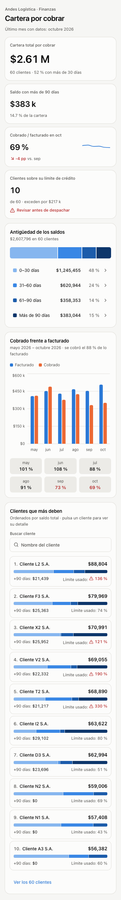 | 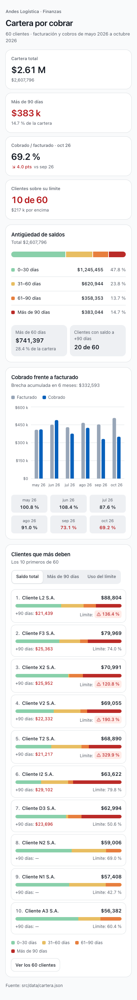 |

**Juez** (X = con skill, Y = sin skill): Ambas resuelven bien las tres preguntas del encargo, con tarjetas en móvil y un drawer de detalle. [con skill] gana para el uso diario: cada tramo de antigüedad filtra la tabla de clientes, tiene buscador con etiqueta visible y estado vacío con salida, y trata la carga (esqueleto), el error (con Reintentar) y el archivo vacío. [sin skill] no tiene ninguno de esos estados porque importa el JSON de forma estática. [sin skill] tiene mejor semántica de color (rampa verde→rojo por riesgo, facturado en gris y cobrado en azul) y ordenación por +90 días o por uso del límite, pero eso no compensa la falta de estados ni de búsqueda.

### p03 · formulario

> Haz el formulario de alta de proveedor: razón social, RUC, persona de contacto, correo, teléfono, banco, número de cuenta, categoría del proveedor y documentos adjuntos (aviso de operación y certificado bancario). Tiene que validar los datos y confirmar el envío. No hay backend: simula el envío.

| Con skill | Sin skill |
|---|---|
| 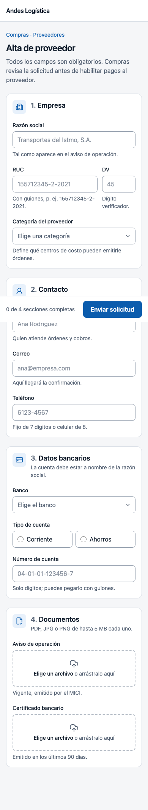 | 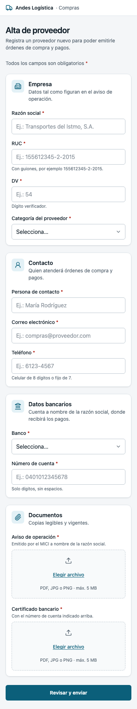 |

**Juez** (X = sin skill, Y = con skill): [con skill] responde mejor al uso diario: barra de envío fija en móvil con progreso «N de 4 secciones», índice lateral con estado por sección en escritorio, aviso de posible proveedor duplicado y un error de envío alcanzable con botón «Reintentar envío». [sin skill] es más limpio y tiene un paso de revisión previo muy bien resuelto, pero es una pila de tarjetas iguales sin ayudas de orientación, y su rama de error de envío nunca se dispara.

### p04 · responsive-tabla-ancha

> El director de operaciones quiere comparar los 40 proyectos activos con sus 12 indicadores (src/data/proyectos.json). Lo consulta casi siempre desde el celular. Haz esa pantalla.

| Con skill | Sin skill |
|---|---|
| 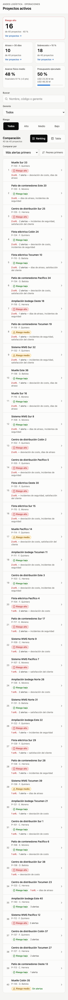 | 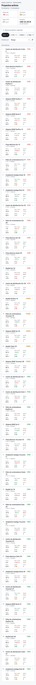 |

**Juez** (X = con skill, Y = sin skill): [con skill] ordena por defecto 'más alertas primero' y dice en cada fila por qué el proyecto preocupa (p. ej. '3 crít. — desviación de costo, días de atraso'), así que en el celular el director sabe qué mirar sin leer números. Además sus KPIs tienen umbrales con sentido (>30 días, >10 %), una comparación (financiero vs físico, +3 pts), filtran al pulsarlos y la pantalla trata la carga, el error con reintento y el vacío. [sin skill] es más densa y compacta, pero pinta casi todas las celdas de color, cuenta 'sobre costo' con cualquier desviación > 0 y no tiene estados de carga ni de error.

### p05 · portal-detalle

> Haz el portal donde el cliente consulta sus facturas: el listado, un filtro por estado y el detalle de cada factura con sus líneas e impuestos. Datos en src/data/facturas.json.

| Con skill | Sin skill |
|---|---|
| 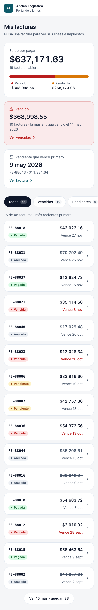 | 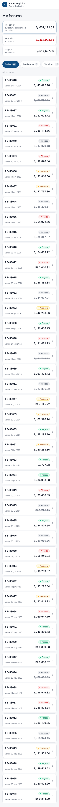 |

**Juez** (X = sin skill, Y = con skill): [con skill] ordena la pantalla según lo que el cliente necesita hacer: el saldo por pagar con su desglose vencido/pendiente, una alerta de lo vencido con acceso directo al filtro y la próxima factura por vencer, y además resalta en rojo las fechas vencidas del listado. También pagina el listado y trata carga (esqueleto), error (con Reintentar) y vacío. [sin skill] es limpio y correcto, pero sus tres cajas de resumen tienen el mismo peso, vuelca las 48 facturas sin paginar y no tiene estados de carga ni de error.

### p06 · landing-formulario

> Haz la página de inscripción al taller cuyo contenido está en src/data/taller.json: de qué trata, la agenda de los dos días, quién lo facilita, el precio, las preguntas frecuentes y el formulario de inscripción.

| Con skill | Sin skill |
|---|---|
| 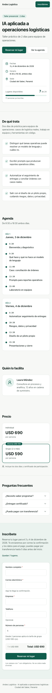 | 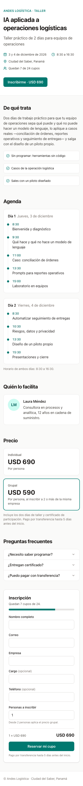 |

**Juez** (X = sin skill, Y = con skill): [con skill] tiene una portada más clara: título, CTA principal y secundario, y una tarjeta con fechas, sede y cupo con su barra. Además trae navegación por secciones, la insignia «Ahorras USD 100» y un formulario más completo: validación al salir del campo, marca de obligatorios, aviso de error de envío y estado de cupo completo. [sin skill] es sólida y su formulario fijo en escritorio es un acierto, pero se ve más plana y no trata el fallo del envío.

### p07 · tablero-operativo

> Haz el tablero de escalamientos de soporte: tickets abiertos por prioridad, cumplimiento del SLA y tiempos de respuesta por agente. Datos en src/data/tickets.json.

| Con skill | Sin skill |
|---|---|
| 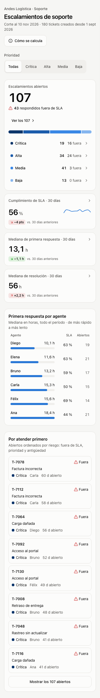 | 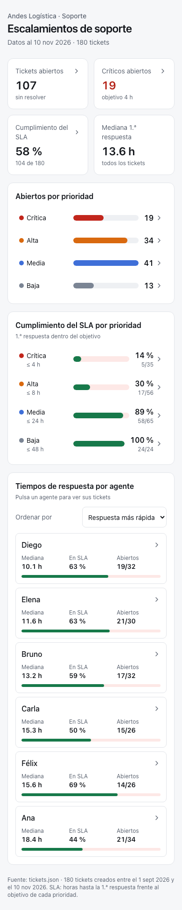 |

**Juez** (X = con skill, Y = sin skill): [con skill] da una cifra protagonista (107 abiertos, 43 fuera de SLA) con desglose por prioridad, compara cada KPI contra los 30 días anteriores y añade una cola «Por atender primero» que dice qué hacer hoy, además de un filtro global de prioridad. También trata carga (esqueleto), vacío y error con reintento, mientras que [sin skill] importa el JSON de forma estática y no tiene ningún estado. [sin skill] es limpio y legible, pero es un informe sin comparación ni acción.

### p08 · estados

> Haz la pantalla de inventario por bodega. Los datos llegan de una API lenta que a veces falla o devuelve la bodega vacía; está simulada en src/lib/api.ts. La pantalla tiene que funcionar bien en todos esos casos.

| Con skill | Sin skill |
|---|---|
| 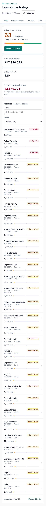 |  |

**Juez** (X = con skill, Y = sin skill): [con skill] arranca por lo que el gerente necesita hacer: una cifra protagonista de artículos por reponer, con su desglose, el costo de reponer y un botón directo a los faltantes; además, cada fila abre un detalle y la lista se pagina de 30 en 30. [sin skill] pone cuatro KPI del mismo peso, vuelca los 120 artículos de una vez (23 000 px a 390 px de ancho) y sus filas no llevan a ningún detalle. Las dos manejan bien la carga, el vacío y el error; [sin skill] además conserva los datos anteriores cuando falla la API.

### p09 · tablero-encuesta

> Haz el tablero de resultados de la encuesta de clima para Recursos Humanos: eNPS, puntaje por dimensión comparado con la medición anterior, resultados por área y los comentarios. Datos en src/data/clima.json.

| Con skill | Sin skill |
|---|---|
| 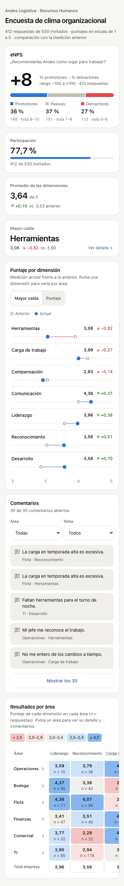 | 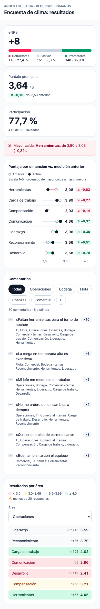 |

**Juez** (X = con skill, Y = sin skill): [con skill] lleva al detalle de forma obvia: cada dimensión, cada área y la tarjeta de mayor caída abren un drawer con foco atrapado, y los comentarios se filtran por área y tema. Además trata los estados de error y vacío y suma la fila de total empresa. [sin skill] se lee muy bien y en móvil pasa la tabla a tarjetas con mejor criterio, pero es una pantalla estática: no tiene drill-down ni estados de carga, vacío o error.

### p10 · configuracion

> Haz la pantalla de configuración de la cuenta: perfil, preferencias de notificaciones, usuarios del equipo con sus roles y una zona para cerrar la cuenta.

| Con skill | Sin skill |
|---|---|
| 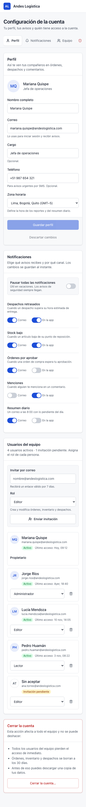 | 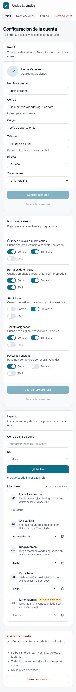 |

**Juez** (X = sin skill, Y = con skill): Visualmente las dos están a la par: limpias, con la zona de cierre bien separada y confirmación por frase. [con skill] gana porque el equipo tiene carga con esqueleto, error con «Reintentar» y estado vacío útil, áreas táctiles de 44 px en switches, botones y selects, y la ayuda del rol visible al invitar. [sin skill] no trata ningún fallo de carga ni de guardado, y sus switches de 24 px quedan chicos en móvil.

## Licencia

MIT. Ver [LICENSE](LICENSE).
